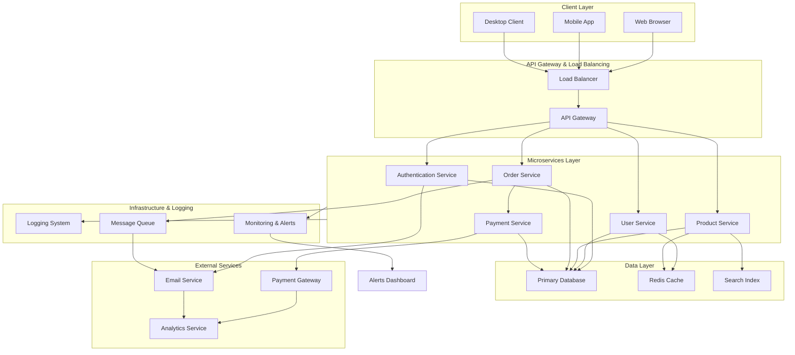

# System Architecture Overview

## High-Level Architecture Diagram

## Architecture Components

### Client Layer
- **Web Browser**: Frontend React/Vue application
- **Mobile App**: Native iOS/Android applications
- **Desktop Client**: Electron-based desktop application

### API Gateway & Load Balancing
- **Load Balancer**: Distributes incoming traffic across multiple API gateway instances
- **API Gateway**: Routes requests to appropriate microservices, handles rate limiting and authentication

### Microservices Layer
- **Authentication Service**: Handles user login, JWT tokens, and session management
- **User Service**: Manages user profiles and account information
- **Product Service**: Manages product catalog and inventory
- **Order Service**: Handles order creation and management
- **Payment Service**: Processes payments and maintains transaction history

### Data Layer
- **Primary Database**: PostgreSQL/MySQL for transactional data
- **Redis Cache**: In-memory cache for frequently accessed data
- **Search Index**: Elasticsearch for full-text search capabilities

### External Services
- **Payment Gateway**: Third-party payment processor (Stripe, PayPal, etc.)
- **Email Service**: Sends transactional and marketing emails
- **Analytics Service**: Tracks user behavior and system metrics

### Infrastructure & Logging
- **Logging System**: Centralized logging (ELK, Splunk)
- **Monitoring & Alerts**: Real-time system health monitoring
- **Message Queue**: Asynchronous task processing (RabbitMQ, Kafka)

---

*This architecture diagram was created with Mermaid and represents a typical microservices-based application structure.*
